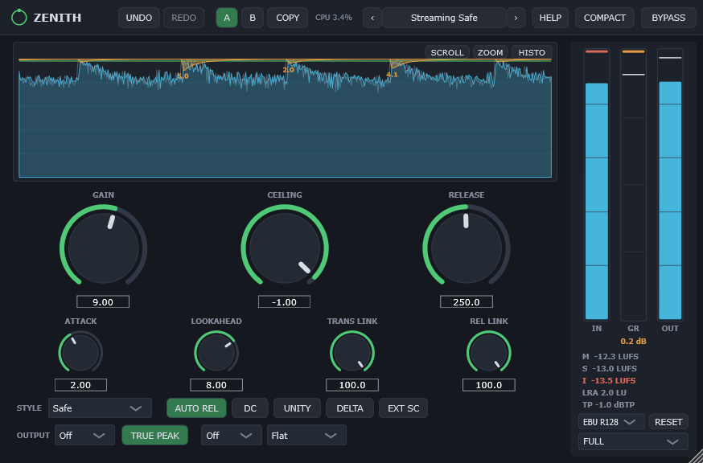
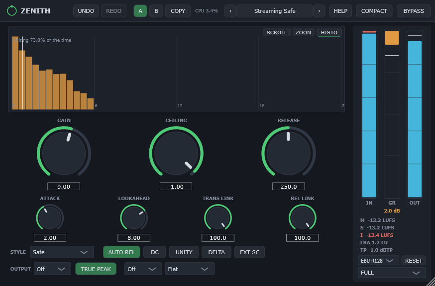
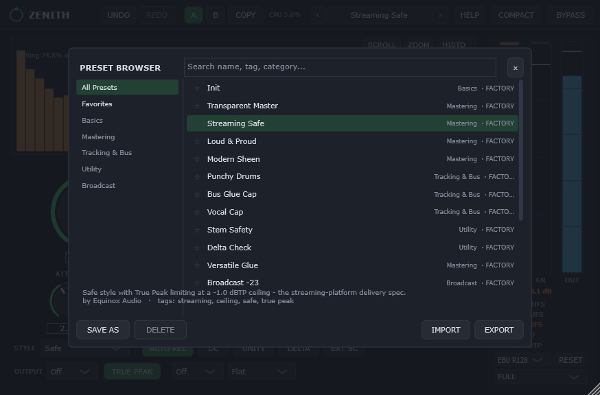

# Zenith

**A free, open-source true peak limiter for mastering.**

Zenith is a lookahead brickwall limiter that is guaranteed never to overshoot its
ceiling. It has eight limiting styles, linear-phase oversampling, a full loudness
meter suite, dithering, stem-mastering sidechain support and surround up to 7.1. It
is part of the **Equinox Audio** family alongside
[Equinox](https://github.com/JDMcE/Equinox) (EQ),
[Meridian](https://github.com/JDMcE/Meridian) (compressor) and
[Horizon](https://github.com/JDMcE/Horizon) (reverb).



<table>
<tr>
<td></td>
<td></td>
</tr>
<tr>
<td align="center"><sub>Gain-reduction histogram</sub></td>
<td align="center"><sub>Preset browser</sub></td>
</tr>
</table>

## Features

- **No-overshoot lookahead limiting** with a hard output ceiling
- **True peak mode**: the ceiling is honoured in dBTP, so inter-sample peaks can't escape
- **8 limiting styles**: Transparent, Punch, Dynamic, Versatile, Aggressive, Modern,
  Bus and Safe
- **Linear-phase oversampling** up to 32x
- **Separate transient and release stereo linking**, plus **Auto Release**
- **DELTA** (hear exactly what the limiter removes) and **UNITY** (level-matched listening)
- **Loudness suite** (BS.1770-4 / EBU R128): Momentary, Short-term, Integrated, LRA
  and max true peak, with EBU R128 and ATSC A/85 targets and K-System meter scales
- **Dither**: TPDF at 16 or 24 bit with Flat, Slope, F-Weighted and E-Weighted noise shaping
- **Stem mastering**: drive every stem's limiter from one shared sidechain so the
  balance between stems is preserved
- Mono, stereo and **surround up to 7.1**
- **Presets**, **A/B comparison** with independent undo per slot, and **MIDI Learn**
- Built-in manual, hover hints, keyboard control and a compact layout

## Download & install

Download the latest build from the
[Releases page](https://github.com/JDMcE/Zenith/releases).

**Windows plugin (64-bit VST3):**

1. Download `Zenith-<version>-win64-vst3.zip` and unzip it.
2. Copy `Zenith.vst3` into `C:\Program Files\Common Files\VST3\`.
3. Restart your DAW or rescan plugins. Zenith appears under **Equinox Audio**.

**Windows standalone app:** no DAW needed. Download
`Zenith-<version>-win64-standalone.zip`, unzip it and run `Zenith.exe`. Pick your audio
device under **Options → Audio/MIDI Settings**.

Prebuilt releases are Windows-only for now. On other platforms you can build from
source (see [For developers](#for-developers)).

## Quick start

1. Set **Ceiling** to your delivery spec. For streaming that's typically
   **-1 dBTP** with **TRUE PEAK** on.
2. Raise **Gain** until the amber GR trace shows limiting on the loud parts, and
   watch the loudness meters for your target.
3. Pick a **Style** for the material and shape recovery with **Release** / **AUTO REL**.
4. Check what you're losing with **DELTA**, and judge fairly with **UNITY**.
5. Try alternatives with **A/B**. Each slot keeps its own undo history.

The full manual is built in: click **HELP → Open Manual**. Hover any control (or press
`H`) for a short explanation.

## Limiting styles

| Style | Character |
|---|---|
| Transparent | Neutral reference: exactly your settings |
| Punch | Short attack window, fast first-stage recovery; drums hit through |
| Dynamic | Programme-dependent release, transient-forward |
| Versatile | Slightly softened all-rounder with a short hold |
| Aggressive | Fast everything; loudness first |
| Modern | Smooth dual-stage release; EDM/pop sheen |
| Bus | Slow, fully channel-linked, glue-like safety cap |
| Safe | Maximum smoothing plus an extra 0.1 dB ceiling margin |

## Keyboard shortcuts

| Keys | Action |
|---|---|
| `Ctrl+Z` | Undo (active A/B slot) |
| `Ctrl+Shift+Z` / `Ctrl+Y` | Redo |
| `A` / `B` | Switch to state A / B |
| `C` | Copy current state to the other slot |
| `P` | Open / close the preset browser |
| `[` / `]` | Previous / next preset |
| `Shift+B` | Toggle bypass |
| `K` | Toggle compact layout |
| `H` | Toggle help hints bar |
| `F1` | Keyboard shortcuts overlay |
| `Esc` | Close overlay / browser |
| `Tab` / `Shift+Tab` | Move focus between controls |
| Arrow keys | Adjust the focused knob |

**MIDI Learn:** right-click any knob, choose **MIDI Learn**, then move a controller.

## Presets

Factory presets are built in. User presets are plain `.znth` files in
`Documents\Zenith\Presets`, so they are easy to back up, sync or share. Use
**IMPORT** / **EXPORT** in the browser to move them between machines.

## Feedback

Found a bug or have an idea? Please
[open an issue](https://github.com/JDMcE/Zenith/issues).

---

## For developers

### Building

Requirements: CMake 3.22+ and a C++20 compiler (developed with Visual Studio 2022).

Zenith shares code with the rest of the family through
[jdm_shared](https://github.com/JDMcE/jdm_shared), which must be checked out next to
this repository:

```
some-folder/
  Zenith/
  jdm_shared/
```

```
git clone https://github.com/JDMcE/Zenith.git
git clone https://github.com/JDMcE/jdm_shared.git
cd Zenith
git clone --depth 1 --branch 8.0.14 https://github.com/juce-framework/JUCE.git libs/JUCE
cmake -B build
cmake --build build --config Release
```

Targets:

- `zenith_VST3` / `zenith_Standalone`: the plugin
  (VST3 output: `build/zenith_artefacts/Release/VST3/Zenith.vst3`)
- `zenith_tests`: offline DSP verification harness (run the built exe; it exits
  non-zero on failure)

### Project layout

```
src/
  Parameters.h          parameter IDs, ranges, APVTS layout
  PluginProcessor.*     audio processing, oversampling, metering, state
  PluginEditor.*        UI: header, main display, knobs, meter strip
  StateManager.h        forwarder for the shared A/B + undo manager
  dsp/
    LimiterEngine.h     lookahead limiter, styles, linking
    TruePeak.h          true peak detection
    Dither.h            TPDF dither + noise shaping
    LoudnessSuite.h     forwarder for the shared BS.1770 loudness suite
  presets/              product config + factory presets for the shared preset manager
  ui/
    MainDisplay.h       level/GR history, zoom and histogram views
    HelpTexts.h         tooltips, shortcut table and the embedded manual
test/
  DspTests.cpp          offline DSP verification harness
```

## License

Zenith is free software, released under the GNU Affero General Public License v3.0;
see [LICENSE](LICENSE). It is built on [JUCE](https://juce.com), used under JUCE's
AGPLv3 open-source licence.
